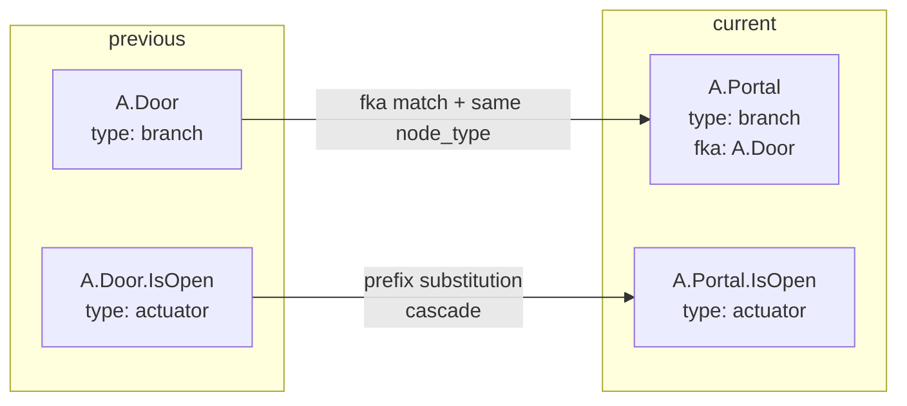
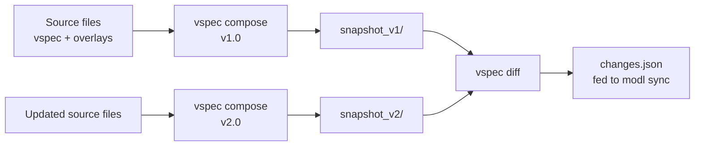

# diff

## What it does

`vspec diff` compares two snapshots produced by `vspec compose` and reports every change as a
structured JSON document in [modl](https://github.com/COVESA/modl)'s adapter intermediate
representation (IR) — ready to be fed straight into `modl sync --diff-report`.

```bash
vspec diff -p snapshot_v1/ -c snapshot_v2/
# or write to file:
vspec diff -p snapshot_v1/ -c snapshot_v2/ -o changes.json
# first-run mode (no previous snapshot): every element is reported as ADDED
vspec diff -c snapshot_v1/
```

## Output structure

```json
{
  "previous": "snapshot_v1/",
  "current":  "snapshot_v2/",
  "changes":  [ ... ],
  "property_paths": [ ... ]
}
```

Each entry in `changes` is a modl IR event. Fields present depend on `kind` and `change_type`:

| Field | Present when | Description |
|---|---|---|
| `label` | always | FQN of the element in the **current** snapshot (or the pre-removal FQN on `REMOVED`). |
| `kind` | always | `ENTITY`, `PROPERTY`, `ENUMERATION_SET`, or `ENUM_VALUE` (see [Kind mapping](#kind-mapping)). |
| `change_type` | always | `ADDED`, `REMOVED`, or `MODIFIED`. |
| `parent_label` | `PROPERTY`/`ENUM_VALUE`, and nested `ENTITY` | Immediate parent's label. |
| `renamed_from` | `MODIFIED` renames only | FQN in the previous snapshot. |
| `aspects` | `ADDED`/`MODIFIED` | Full snapshot on `ADDED`; changed-keys-only delta on `MODIFIED`, each value wrapped with `_op` (see [Aspect wrapping](#aspect-wrapping-on-modified-events)). Empty `{}` on `REMOVED`. |
| `previous_aspects` | `REMOVED` only | Full prior-state snapshot of the removed element — mandatory and non-empty. |
| `content` | `MODIFIED` `ENTITY`/`ENUMERATION_SET` | List of `{label, change_type}` summarising which children changed. |
| `is_leaf` | every `PROPERTY` event | `true` for a primitive/scalar property (binding-eligible); `false` when the property references another entity. Mandatory on every `PROPERTY` event (`ADDED`/`REMOVED`/`MODIFIED`), reflecting the current (or, on `REMOVED`, previous) state. Forbidden on `ENUM_VALUE`. See [is_leaf](#is_leaf). |
| `references` | struct-typed `PROPERTY` events only | `{"output_type": "<struct label>"}` declaring the struct entity this property's `output_type` points at. `ADDED`: always present for non-leaf properties. `MODIFIED`: present only when `datatype` changed — omitted otherwise to keep modl's stored edge. Forbidden on `REMOVED` and `ENUM_VALUE`. See [references](#references). |

## Kind mapping

`vspec diff` maps VSS node types to modl IR kinds:

| VSS source | node `type` | modl `kind` |
|---|---|---|
| model / structs | `branch` / `struct` | `ENTITY` — and also `PROPERTY` if it has a parent, see [Branch duality](#branch-duality) |
| model / structs | any signal type (`sensor`, `actuator`, `attribute`) | `PROPERTY` |
| quantities | — | `ENUMERATION_SET` |
| units | — | `ENUM_VALUE` |

## Branch duality

VSS has no separate standalone-type layer: a branch's name is just its path segment, exactly like a
leaf signal's. This means a nested branch plays **two roles at once** — the same way a GraphQL field
like `cabin: Cabin` is both a `PROPERTY` on its parent type and a standalone `ENTITY`:

```graphql
type Vehicle {
  cabin: Cabin   # Vehicle.cabin is a PROPERTY of Vehicle, resolving to the Cabin ENTITY
  model: String  # Vehicle.model is a PROPERTY of Vehicle, resolving to a primitive
}
```

```yaml
Vehicle.Cabin:    # reported as BOTH an ENTITY (Cabin the container) ...
  type: branch    # ... AND a PROPERTY of Vehicle (Vehicle has-a Cabin)
```

Rule: every branch/struct that has a parent (i.e. its FQN contains a `.`) is reported as **both**:
- an `ENTITY` event, carrying its real attributes (`description`, `instances`, etc.), and
- a `PROPERTY` event with `parent_label` set to the immediate parent, carrying only
  `is_list` (`true` when the branch defines `instances`) and `is_required` — never `output_type`,
  since vspec branches have no standalone type to point to. This `PROPERTY` event always has
  `is_leaf: false`, since it references another entity (the branch/struct itself) rather than a
  primitive value.

Root-level branches (no parent, e.g. the top-level `Vehicle` branch) are reported as `ENTITY` only —
there is nothing for them to be "a field of".

On `MODIFIED`, both events are **always** emitted together, even when the change (e.g. a description
edit) has no property-relevant effect — in that case the `PROPERTY`-side event simply carries empty
`aspects: {}`. When the change is instance-relevant (instances added/removed), the `PROPERTY`-side
event carries a wrapped `is_list` delta if it flips between `true`/`false`.

## is_leaf

`is_leaf` is a first-class field on `PROPERTY` events — not an aspect — required by modl so it
knows which properties are eligible for binding generation: only leaf (primitive/scalar) properties
get bindings; properties that reference another entity never do.

It is derived with three rules:

1. **Branch/struct duality pointer events** (see [Branch duality](#branch-duality)) always get
   `is_leaf: false` — they represent a reference to another entity by construction.
2. **Struct fields** (properties declared inside a `struct`, i.e. sourced from `structs.vspec`)
   always get `is_leaf: false` and never `binding_eligible: true`, regardless of their own
   `datatype` — a struct has no standalone runtime address of its own, so its fields are never
   independently addressable and never get a `property_paths` entry either (see
   [property_paths](#property_paths)). Only the property that references the struct (reported
   with `binding_eligible: true`) is binding-eligible; `references`/`output_type` for a struct
   field is still derived from its real `datatype`, unaffected by this rule.
3. **Real signals** get `is_leaf` based on whether their base `datatype` (stripped of any
   trailing `[]`) resolves to a known primitive VSS type. A `sensor`/`actuator`/`attribute`
   whose `datatype` names a struct (e.g. `datatype: VehicleDataTypes.MyStruct`) is
   `is_leaf: false`, even though it isn't a duality pointer itself:

```yaml
A.Speed:
  type: sensor
  datatype: float                          # primitive → is_leaf: true

A.RichSensor:
  type: sensor
  datatype: VehicleDataTypes.MyStruct      # struct reference → is_leaf: false
```

`is_leaf` is never present on `ENUM_VALUE` events.

## references

`references` declares which `ENTITY` a struct-typed property's contract depends on, as a
`{"output_type": "<struct label>"}` map. This lets `modl` cascade a new contract onto the property
whenever the referenced struct itself gets a new contract (see modl's own
`diff_report_template.md` for the full cascade rules), without vss-tools having to compute any
digest or helper aspect.

`output_type` is the only role vss-tools ever declares: it is the only VSS aspect whose value names
another `ENTITY` (a struct). Units are plain opaque strings matching an `ENUM_VALUE` label, not an
`ENTITY`/`ENUMERATION_SET` label, so they are never eligible for `references` and are not declared.

- **ADDED**: always present for a non-leaf property (`is_leaf: false`), carrying the struct label
  from `aspects.output_type`.
- **MODIFIED**: present only when `datatype` changed in this release:
  - the property now points at a struct (newly or retargeted to a different one) →
    `{"output_type": "<new struct label>"}`
  - the property now resolves to a primitive, dropping a previously-held struct reference → `{}`
  - `datatype` unchanged → `references` is omitted entirely, keeping modl's stored edge (e.g. a
    plain description edit on a struct-typed property never touches `references`).
- **REMOVED**: never present — forbidden by the modl IR.
- **`ENUM_VALUE`**: never present — forbidden by the modl IR.
- **Branch/struct duality pointer events** (see [Branch duality](#branch-duality)): never present —
  these events never carry `output_type` in the first place.

```yaml
A.Location:
  type: sensor
  datatype: Types.Position
```

```json
{
  "label":        "A.Location",
  "parent_label": "A",
  "kind":         "PROPERTY",
  "change_type":  "ADDED",
  "is_leaf":      false,
  "binding_eligible": true,
  "references":   { "output_type": "Types.Position" },
  "aspects": { "output_type": "Types.Position", "is_list": false, "is_required": false }
}
```

## Aspect wrapping on MODIFIED events

Every changed key in a `MODIFIED` event's `aspects` is wrapped with an `_op` annotation, per the modl
IR contract:

```json
"aspects": {
  "unit":        { "_op": "added",    "_value": "mph" },
  "accuracy":    { "_op": "removed",  "_previous": 0.5 },
  "description": { "_op": "modified", "_value": "new text", "_previous": "old text" }
}
```

The two exceptions are the directional instance dimension-map keys, which stay as plain unwrapped
maps since they carry a per-dimension delta rather than a single old/new pair. `instances`,
`instances_added`, and `instances_removed` all share the same dimension-map shape: one entry per
instance dimension, positionally named `dimension1`, `dimension2`, ... (no Cartesian join across
dimensions):

```json
"aspects": {
  "instances_added":   { "dimension1": ["Center"] },
  "instances_removed": { "dimension2": ["Row3"] }
}
```

## Change types

**ADDED** — a node exists in current but not in previous. `aspects` carries the full attribute
snapshot.

**REMOVED** — a node exists in previous but not in current. `aspects` is empty; `previous_aspects`
carries the full attribute snapshot as it existed before removal.

**MODIFIED** — a node exists in both, but something changed. This covers:
- attribute value changes (datatype, unit, description, etc.) — wrapped with `_op`
- instance list changes — reported as `instances_added`/`instances_removed` deltas
- renames detected via the `fka` ("formerly known as") field — reported via `renamed_from`

## Rename detection

Renames are detected automatically without requiring any extra flags.



1. **Explicit rename** — if an added node has `fka: [old.path]` and the same `type` as the removed
   node, it is reported as `MODIFIED` with `renamed_from`.
2. **Cascade** — children of a renamed branch are matched by FQN prefix substitution. Each cascaded
   child is independently checked for attribute changes too.

If `fka` is missing, or the node type doesn't match, the pair is reported as independent `REMOVED` +
`ADDED`.

## property_paths

Alongside `changes`, every binding-eligible `PROPERTY` (`is_leaf: true`, or `binding_eligible: true`
for struct-typed properties) gets an entry in the top-level `property_paths` list, declaring every
concrete literal runtime path at which it occurs:

```json
{
  "label": "Vehicle.Axle.Wheel.Speed",
  "parent_label": "Vehicle.Axle.Wheel",
  "paths": [
    { "tags": { "Vehicle.Axle": { "dimension1": "Axle1" }, "Vehicle.Axle.Wheel": { "dimension1": "Left" } },
      "path": "Vehicle.Axle.Axle1.Wheel.Left.Speed", "change": "unchanged" },
    { "tags": { "Vehicle.Axle": { "dimension1": "Axle1" }, "Vehicle.Axle.Wheel": { "dimension1": "Right" } },
      "path": "Vehicle.Axle.Axle1.Wheel.Right.Speed", "change": "unchanged" }
  ]
}
```

- **Paths come from the vss-tools tree.** Each snapshot's `model.vspec` is parsed and
  instance-expanded with the same tree code `vspec export` uses, for both the previous and the
  current snapshot, and the leaf paths (`sensor`, `actuator`, `attribute`) of the two trees are
  compared. Reported paths are therefore exactly the leaf paths an expanded export would contain:
  instanced ancestors fan out into one entry per combination, each hop appearing after the
  entity's own name (`Vehicle.Axle.Axle1.Wheel.Left.Speed`), `instantiate: false` pins a leaf to
  its parent, a leaf declared below an instance (`Vehicle.Foo.Red.Extra`) exists for that instance
  only, and `instances_relation: sibling` is followed as the tree resolves it. A snapshot model
  the tree cannot expand fails the diff instead of producing guessed paths.
- **`tags`** maps each instanced entity's FQN label to the `{dimension1: value, ...}`
  combination it contributed to that path — the same dimension-map shape used for `instances`. This
  is the canonical identity used for `change` classification: renaming an instanced ancestor changes
  the literal `path` string but not its `tags`, so the entry stays `"unchanged"` (only `path` is
  refreshed) rather than manufacturing a spurious add+remove pair.
- **`change`** is `"added"`/`"removed"`/`"unchanged"` for that specific path+tags combination,
  independent of the parent property's own `change_type` — e.g. an entity gaining a new instance
  value re-reports every property under it with one new `"added"` path entry, even though the
  property itself has no event of its own in `changes` (the *entity instance-delta cascade*).
- **Struct fields never get their own entry.** A struct has no standalone runtime address of its
  own — only the property that references the struct (reported with `binding_eligible: true`) gets
  a `property_paths` entry, at its own path. Struct members are not flattened onto usage sites.

### Consistency between `changes` and `property_paths`

`changes` are computed on the authored snapshot entries, `property_paths` on the expanded trees.
Both live in one report and are kept consistent by these rules (enforced by
`tests/vspec/test_diff/test_diff_path_consistency.py`):

1. **Completeness** — every binding-eligible model `PROPERTY` event has exactly one `property_paths`
   entry with the same `label` and `parent_label`.
2. **Soundness** — every entry is justified by its own event, or by an `ENTITY` `MODIFIED` event with
   `instances_added`/`instances_removed` for an entity in the entry's `tags`.
3. **Event to path** — `ADDED` → all paths `added`; `REMOVED` → all paths `removed`. A `MODIFIED`
   property has `added`/`removed` paths only because a tagged entity changed its instances or the
   property's effective `instantiate` flipped; otherwise all paths are `unchanged`.
4. **Path to cause** — an `added` path on a property present in both snapshots requires
   `instances_added` on a tagged entity (or an `instantiate` flip); a `removed` path requires
   `instances_removed` (or a flip).
5. **Path integrity** — `added`/`unchanged` paths exist in the current tree, `removed`/`unchanged`
   paths in the previous tree (previous paths pass through the ancestor-rename map), and no path
   is reported twice. Struct fields never have entries.
6. **Tag validity** — tag keys are entity labels and each tag value is one of that entity's
   instance values on the side the path belongs to.
7. **No instance branch events** — instance branches (`Vehicle.Axle.Axle1.Wheel.Left`) are never
   reported as entities; instances are an aspect of the authored entity and expanded paths only
   appear in `property_paths`. Every `ENTITY`/`PROPERTY` event carries an authored label.
8. **Parent integrity** — every `parent_label` is either an `ENTITY` event of the report or an
   entity already authored in the previous snapshot, and every `ENTITY` `MODIFIED` event refers to
   an entity that existed in the previous snapshot (a first run has none). A leaf declared below an
   instance (`Vehicle.Foo.Red.Extra`) is anchored to its nearest authored ancestor
   (`Vehicle.Foo`), never to the implicit `Vehicle.Foo.Red`.

## Example output

```json
{
  "label": "A.Portal",
  "kind": "ENTITY",
  "change_type": "MODIFIED",
  "parent_label": "A",
  "renamed_from": "A.Door",
  "aspects": {},
  "content": [
    { "label": "A.Portal.IsOpen", "change_type": "MODIFIED" }
  ]
},
{
  "label": "A.Portal",
  "kind": "PROPERTY",
  "parent_label": "A",
  "change_type": "MODIFIED",
  "renamed_from": "A.Door",
  "aspects": {},
  "is_leaf": false
},
{
  "label": "A.Portal.IsOpen",
  "kind": "PROPERTY",
  "parent_label": "A.Portal",
  "change_type": "MODIFIED",
  "renamed_from": "A.Door.IsOpen",
  "aspects": {
    "output_type": { "_op": "modified", "_value": "string", "_previous": "boolean" }
  },
  "is_leaf": true
}
```

The `A.Portal` branch rename produces both its `ENTITY` event (with `content` summarising its
changed child) and its `PROPERTY` event (since it has a parent, `A`) — per [Branch duality](#branch-duality).

## Typical workflow



## About breaking changes
The `diff` command is intentionally reporting ANY change without dictating what constitutes a
breaking change. That distinction is handled downstream by `modl sync`'s breaking-change
configuration.
